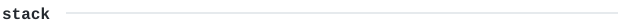
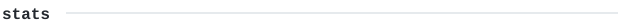

<samp>
<a href="mailto:mithil.bhansali@gmail.com">email</a> &nbsp;·&nbsp;
<a href="https://www.linkedin.com/in/mithil-bhansali/">linkedin</a> &nbsp;·&nbsp;
<a href="https://www.instagram.com/bhansali_mithil/">instagram</a> &nbsp;·&nbsp;
<a href="https://vsco.co/monstervm">vsco</a>
</samp>

 

> Mithil Bhansali.
> TODO: one line on where you are and what you study.
>
> TODO: a short line you actually believe about how you build.

TODO: two or three sentences — what you are building right now, and what you
keep circling back to. Name the thing, link it, say what it does. Write it in
your own voice; it is the only part of this page a person reads slowly.

<samp>
TODO &mdash; the things you would be happy to be handed a ticket in.
Lowercase, comma-separated, no icons: javascript, python, html, css, git
</samp>

<samp>
Every graphic above is an SVG in this repo, redrawn each morning by
<a href="./.github/workflows/stats.yml">a scheduled Action</a> from the GitHub
GraphQL API. Language totals cover public repos only.
</samp>
